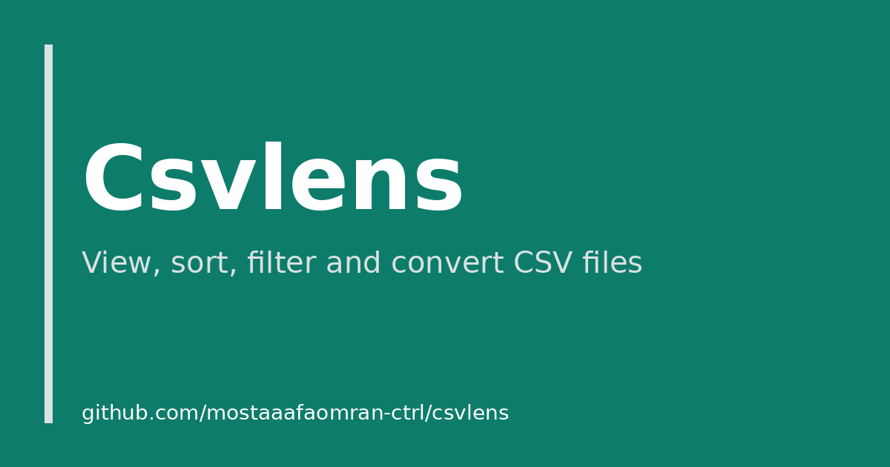

# Csvlens

View, sort, filter and convert CSV files.

 

**Live demo:** https://mostaaafaomran-ctrl.github.io/csvlens/ (add `?demo=1` to see it filled with sample data)

Open a CSV, sort and filter it, see column stats, export as JSON, Markdown table or CSV. Nothing is uploaded.

## Features

- Auto-detects comma, semicolon and tab
- Click a header to sort (numbers sort as numbers)
- Filter across all columns while you type
- Column stats: unique, min, max, mean, median, top values
- Export filtered rows as CSV, JSON or Markdown

## Run it locally

It is one `index.html` file. Open it in a browser. No build step, no dependencies, no server.

## Privacy

Everything runs in your browser. Nothing is uploaded. Data you enter is kept in your browser's local storage on your device only.

## بالعربي

افتح ملف CSV، رتّبه وفلتره وشوف إحصائيات كل عمود، وحوّله JSON أو جدول Markdown. من غير رفع ملفات.

افتح الملف `index.html` في المتصفح وهيشتغل على طول، من غير تسجيل ومن غير سيرفر.

## License

MIT
